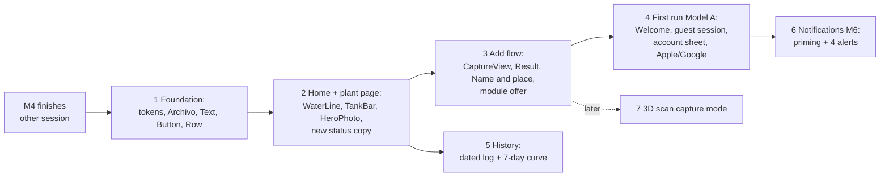

# Plant Care: design roadmap

_Status: approved by the owner 2026-11-19; the open decisions in §4 are still open. This is the order in which to build Direction E and Model A, what conflicts with already-approved specs or code, what the owner still has to decide, and a self-check of the design package._

## 1. Order of work

Each phase is one feature branch with its own PR, as CLAUDE.md requires. Phases 1–3 are pure app work. Phase 4 needs backend and security work.

| Phase | Scope | Depends on | Size |
|---|---|---|---|
| 1 Foundation | `colors.ts`, `typography.ts` (Archivo, six sizes plus `display`), `Button`, `Row`, `StepProgress` restyled; removed tokens deleted and their uses moved | Owner OK for the font asset | S |
| 2 Home + plant page | `WaterLine`, `TankBar`, `HeroPhoto`; Home sections and grid; plant page layout; status copy without middle dots; "no module" and "wet" regrouped | M4 merged (status.ts, TankVessel, StatusBanner are M4 files) | M |
| 3 Add flow | `CaptureView` (photo mode), Result redesign with confidence words, room chips, light choice, module offer; route `add/photo` → `add/capture` | Phase 1; a light column if it doesn't exist | M |
| 4 First run | Welcome, anonymous sign-in, guest identify limit, captcha, account sheet, turning the guest into an account, Apple and Google sign-in, the health step moved after the account | **Owner approval plus an Opus security review** (auth, RLS, Edge Function limits) | L |
| 5 History | Dated log merging photos and events; moisture curve from `readings` | Phase 2; M4 readings | M |
| 6 Notifications | Priming screen; push for tank, fault, offline, battery | M6 | M |
| 7 3D scan | Scan mode in `CaptureView`; capture type that isn't a JPEG | Hardware and vision decision | L |

## 2. What doesn't change

All of the following stay exactly as built:
- RLS, column grants and the service-role grants.
- The photo privacy rules.
- The watering safety limits.
- The loading rules and the TanStack Query cache behaviour.
- Light being the default appearance.
- No `<StatusBar>`.
- `Animated` rather than Reanimated.
- Press handlers that stay synchronous.

## 3. Conflicts with approved specs and code

These are listed for the owner to decide. None has been changed in code or in the older specs.

| # | Where | Today | Proposed | Why |
|---|---|---|---|---|
| 1 | `2026-11-17-app-ui-design.md` §2–3 | Glazed Ceramic: paper #F4F1EB, serif titles, green tint | Direction E (DESIGN_SYSTEM) | Owner: "still has a bit of an AI look"; the frontend-design skill lists that exact palette as a generated-UI cliché |
| 2 | `colors.ts` | statusFine / Soon / Quiet, band, nowFill, soonFill | Removed; red and water only | One signal colour; the owner found multiple colours "fight" |
| 3 | `typography.ts` | New York serif titles, 34/28 | Archivo, six sizes plus display 40 | Owner: font sizes "a bit weird" |
| 4 | App UI spec §4, auth routing | Sign-up is the first screen | Model A: scan first, account at "Save {name}" | Owner: "shouldn't start with sign up" |
| 5 | M4 `status.ts` | No module = `setup`, "Setup isn't finished · Add its module", counted under Needs you | "No module" under Doing well | A plant without hardware is a valid, finished state |
| 6 | M4 `status.ts` | `wet` = level "soon" (Needs you) | Doing well | The module handles it; no person needs to act |
| 7 | M4 status copy | Middle dots ("Doing well · …") | One sentence; extra detail on the plant page | Middle-dot strings are a generated-UI tell; one sentence per plant |
| 8 | M4 `StatusBanner`, `TankVessel` | Tinted banner; vessel drawing | Headline + line; `TankBar` / `WaterLine` | No tinted banners; the water line is the signature |
| 9 | Home `+` | "Add a pot" | "Add a plant" | One name per object |
| 10 | Add flow order | photo → identify → where → health, all after sign-up | capture → result → name and place → **account** → health → module offer | Model A; health results must be saved to an account |
| 11 | Plant detail | Photo strip, health card, module rows | Hero, status, tank bar, three rows, history row | Planta-style hierarchy without its chores |
| 12 | `add/photo` route name | photo | capture | A 3D scan is coming |
| 13 | CLAUDE.md "Launch" rule and `src/launch` | Draw 0.7 s, rest 0.5 s, fade; about 1.45 s, taps blocked | Draw, then fade when ready; tap to skip; no rest (decided 2026-11-19) | Android guidance is 1 s or less and skippable; QA satisfaction report. Update CLAUDE.md when it's built |

**Recommendation:** approve 1–4 and 7–13 with this package. For 5 and 6, wait until M4 is merged, then make them a small follow-up so the M4 session isn't disrupted.

## 4. Open decisions

1. **Guest sessions (Model A).** Decided 2026-11-19: yes. Anonymous sign-in, 3 identifications per install for guests, and a captcha on guest sign-in. It still gets an Opus security review when built (phase 4).
2. **Apple and Google sign-in.** Decided 2026-11-19: deferred to M8. Launch is email only, so the account sheet shows "Continue with email" alone until then.
3. **A guest plant when signing in to an existing account.** Decided 2026-11-19: add it. After sign-in the app saves the pending plant (re-uploading its photo from the phone) to the existing account. Guest leftovers on the server are cleaned up. The account sheet gets an "I already have an account" link.
4. **Font asset.** Decided 2026-11-19: Archivo is approved "for now" (static TTFs).
5. **Light per plant.** Decided 2026-11-19: `plants.light` added in Phase 3 (same values as `species.light`).
6. **Analytics.** The success measures in PRODUCT_VISION §5 can't be tracked today. Add analytics, or drop the targets?
7. **Paid features.** Which features `useEntitlement()` will gate. The design assumes safety messages and the plant itself are always free.
8. **The older UI spec.** Mark `2026-11-17-app-ui-design.md` as superseded for visuals once this package is approved. I haven't edited it.

## 5. Self-check of this design package

| Check | Result |
|---|---|
| Research before design, with sources | Yes: Lazyweb result refs and the Planta App Store listing, in DESIGN_RESEARCH §7, §6b, §6c. Coverage was thin (no Planta, Greg or Blossom flows); this is stated, not hidden |
| At least three genuinely different directions | Yes: A Care Card, B Field Journal, C Instrument ([directions.html](directions.html)), then D (Planta-informed) and E (chosen) after owner feedback |
| No purple or blue gradients, glassmorphism or card overload | No gradients. The only frosted elements are two 44 pt buttons over photos. List items aren't boxed |
| No arbitrary icons, generic dashboards, unnecessary charts | Icons only for back, more, close, add, chevron. One chart, behind History |
| No AI marketing copy | Copy is functional and names the plant: "Tank needs refilling", "Save Stripes". No "AI-powered", no exclamation marks |
| Avoids the frontend-design cliché list | No cream + serif + terracotta, no all-caps eyebrows, no middle-dot meta strings, no '→' buttons, no monospace labels |
| Distinctive and specific to this product | The water line under every photo exists because the product has a tank; condensed names echo nursery tags |
| Accessible | Contrast calculated (DESIGN_SYSTEM §1). The one shortfall (light water line 1.7:1) is always paired with text. Status is never colour alone; 44 pt targets; Dynamic Type uncapped; Reduce Motion handled |
| Every state designed | Loading, empty, offline, error, limit, expired, never-connects, low confidence, camera denied (UX_ARCHITECTURE §8) |
| Consistent naming | plant, module, tank everywhere; the conflict ("Add a pot") is listed |
| Future 3D scan accommodated | One capture step with one output type; both modes mocked |
| Conflicts surfaced, not overwritten | §3: twelve conflicts; no spec or code edited |
| Working rules | No app code modified. No dependencies installed by me (the `frontend-design` skill was installed at the owner's request, into `.agents/` and `.claude/skills/`, which also changed `skills-lock.json`). Nothing committed or pushed |

**Known gaps:**
- Dark mode is specified but not mocked.
- Settings, Sign in and the History screen aren't mocked.
- Tablet layouts aren't covered.
- The Android-specific details (Material Symbols, back gesture) follow platform defaults and aren't drawn.
