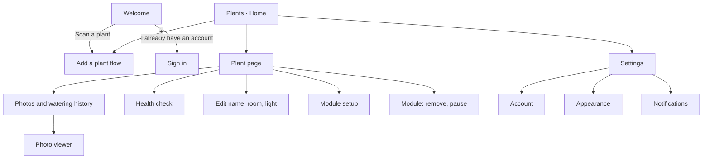
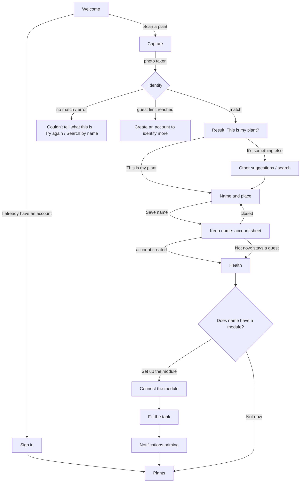
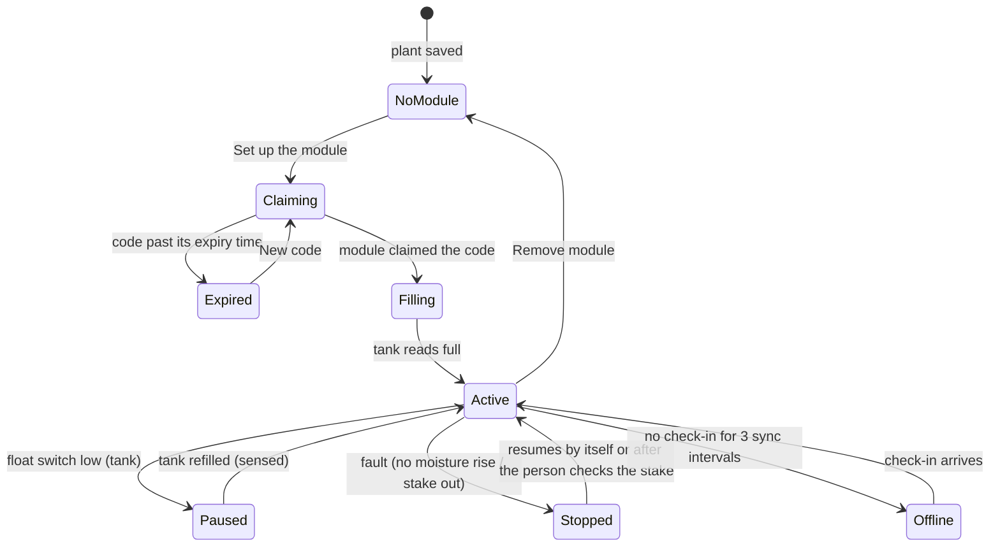

# Plant Care: UX architecture

_Status: approved by the owner 2026-11-19. Visual direction: Direction E ([direction-e.html](direction-e.html)). First run: Model A ([flow-e.html](flow-e.html))._
_Where this disagrees with `docs/superpowers/specs/2026-11-17-app-ui-design.md` or the M4 spec, the conflict is listed in [DESIGN_ROADMAP §3](DESIGN_ROADMAP.md#3-conflicts-with-approved-specs-and-code). Nothing here changes code by itself._

## 1. Information architecture

There are three kinds of object, each with one name used everywhere:

| Object | User-facing name | Never call it |
|---|---|---|
| A living plant the person owns | **plant** ("Stripes") | pot, item, entry |
| The hardware (saucer, tank, stake, controller) | **module** | device, pot, sensor, smart pot |
| The water container in the saucer | **tank** | reservoir, saucer |

**Conflict to fix:** today the `+` button's label says "Add a pot". It should read "Add a plant".

**Navigation model.** There is one stack, rooted at Plants (Home), with no tab bar: with one main list and one detail page, tabs would be empty chrome. Settings opens from the Home header. Setup flows open as full-screen modal stacks with a close button. Sheets keep Done in their header, and screens with a primary action pin it in `BottomBar`, as CLAUDE.md requires.

## 2. Screen inventory

Under "Today", **exists** means the screen is built and only restyled. **Change** means its behaviour or copy changes. **New** means it doesn't exist yet.

| # | Screen | Route | Today | Purpose |
|---|---|---|---|---|
| 1 | Welcome | `(welcome)/index` (new group) | new | One sentence about the product; "Scan a plant"; "I already have an account" |
| 2 | Capture | `add/photo` → rename to `add/capture` | change | Camera opens straight away; library fallback; later a 3D scan |
| 3 | Result | `add/identify` | change | Best match large, with "This is my plant" and "It's something else" |
| 3a | Other suggestions and search | `add/search` | exists | Up to 3 alternatives plus name search |
| 4 | Name and place | `add/where` | change | Name, room chips, light as three choices; "Save {name}" |
| 5 | Keep {name} (account sheet) | `(auth)/save` sheet | new | Apple, Google, email; turns the guest into an account |
| 6 | Health | `add/health` | change | Runs after the account, so its result is stored |
| 7 | Module offer | `add/module-offer` | new | "Does {name} have a module?" |
| 8 | Connect the module | `plant/[id]/module` | exists (M4) | Claim code, waiting, expiry, help |
| 9 | Fill the tank | `plant/[id]/tank` | exists (M4) | Tank fills by itself; "The tank is full." |
| 10 | Notifications priming | `plant/[id]/notify` | new (M6) | Real example alerts, then the system prompt |
| 11 | Plants (Home) | `(app)/index` | change | "{n} need you" first, then "{m} doing well" grid |
| 12 | Plant page | `plant/[id]/index` | change | Hero photo, status sentence, tank bar, three rows, history row |
| 13 | Photos and watering history | `plant/[id]/photos` → `plant/[id]/history` | change | Dated log mixing photos, drinks and events; 7-day moisture curve at the top |
| 14 | Photo viewer | `plant/[id]/photos/[photo]` | exists (M3) | Swipe, health result, delete |
| 15 | Health check | `plant/[id]/health` | exists | New capture and result |
| 16 | Edit | `plant/[id]/edit` | exists | Name, room, light, species |
| 17 | Settings | `(app)/settings` | change | Account, appearance, notifications, sign out, delete account |
| 18 | Sign in | `(auth)/sign-in` | exists | For returning people only |
| 19 | Sign up (email) | `(auth)/sign-up` | change | Reached from the account sheet's "Continue with email" |
| 20 | Email confirmed | `email-confirmed` | exists | Landing after the confirmation link |

The route names under `(welcome)` and `(auth)/save` are proposals. The implementation plan fixes them.

## 3. First run (Model A)

The account is asked for at the first moment there is something to lose: a named, saved plant. Evidence is in [DESIGN_RESEARCH §6c](DESIGN_RESEARCH.md#6c-first-run-without-sign-up-first-2026-11-19).

**Rules.**
- **Guest session.** The person gets an anonymous Supabase session when they tap "Scan a plant". A guest can run **3** identifications per install, proposed in place of the 20 a day that account holders get, and the session start is protected by a captcha. Approved by the owner 2026-11-19; it still gets a security review when built (see roadmap).
- **The plant is saved as the guest at "Save {name}".** It survives closing the app, email confirmation and sign-in. Turning the guest into an account keeps the same user id. Signing in to an existing account adds the plant there (decided 2026-11-19). Closing the account sheet returns to Name and place with nothing lost. The sheet also offers a neutral "Not now" (decided 2026-11-19): the plant stays on this phone as a guest, Home and Settings show a quiet "Keep your plants" row, and setting up a module requires an account.
- **The order of the last steps is fixed.** Health runs after the account so its result is stored. Notification permission is asked only after the first module is set up, never at launch.
- **Second way in: start from the module.** The Welcome screen may later offer "Set up a module". It runs account → Connect → Fill the tank → Capture (Model C as a branch). It's not in the first build.

## 4. Adding more plants (signed in)

The same steps, without Welcome or the account sheet: `+` → Capture → Result → Name and place → Health → Module offer. The module offer only appears if the person has a module that isn't paired yet, or has never set one up.

## 5. Module setup and life

The rule of 410 twice in a row meaning "unpaired" stays as built in M4.

## 6. Status grammar

Each plant shows **one** sentence. The first rule that matches wins, in the same order as `apps/mobile/src/devices/status.ts`. The copy drops the middle dots (see [DESIGN_SYSTEM §6](DESIGN_SYSTEM.md#6-writing)).

| Order | Key | Group on Home | Sentence on Home | Plant page headline + line |
|---|---|---|---|---|
| 1 | no module | **Doing well** (changed) | No module | "No module yet" / "Photos and health checks only. Set up a module to water it automatically." |
| 2 | fault | Needs you (red) | Watering stopped | "Watering stopped" / the existing M4 banner text, which says what to check |
| 3 | tank | Needs you (red) | Tank needs refilling | "Tank needs refilling" / "Watering is paused. It starts again by itself once you top it up." |
| 4 | offline | Needs you (ink) | Not heard from since {time} | "Not heard from since {time}" / "It may be out of Wi-Fi range or its battery may be flat." |
| 5 | waiting | Doing well | Waiting for its first check-in | the same text / "This can take a few minutes after setup." |
| 6 | wet | Doing well (changed) | Soil is very wet | "Soil is very wet" / "Watering is on hold until it dries a little." |
| 7 | battery | Needs you (ink) | Battery low | "Battery low" / "Charge the module in the next few days." |
| 8 | fine | Doing well | Next drink in about {n} days, or "Learning how fast it drinks" | "Water left for about {n} days" / "Next drink in about {n} days." Before there is drink-rate data: "Learning how fast it drinks" / "It waters itself when the soil starts to dry." |

**Changes from M4:**
- "no module" moves from Needs you to Doing well.
- "wet" moves from "soon" to Doing well, because the module handles it and no person needs to act.

**Colour rule.** Red is used only for fault and tank, the two states where only a person can fix it. Offline and battery are in Needs you but shown in ink. Both changes are listed as conflicts for the owner.

## 7. Notifications (M6)

| Event | Notify? | Text |
|---|---|---|
| Tank low | yes, once, plus one reminder after 24 h | "{name}: the tank needs refilling. Watering is paused until then." |
| Fault | yes, once | "{name}: watering stopped. Check the stake is in the soil." |
| Offline > 12 h | yes, once | "{name}: not heard from since {time}. The module may be out of Wi-Fi range." |
| Battery < 15 % | yes, once per charge | "{name}: the module's battery is low." |
| Watered fine, waiting, wet | **never** | none |

Each alert fires once per condition and is removed from Notification Centre when the condition clears.

## 8. Edge cases

| Situation | What the person sees |
|---|---|
| Camera permission denied | Capture shows "Plant Care needs the camera to see your plant." with "Open Settings" and "Choose a photo instead" |
| Photo too dark or blurry, or Plant.id gives no match | "Couldn't tell what this is." with "Try another photo" and "Search by name" |
| Low confidence (below 0.5) | Result header "Might be" instead of "Very likely"; the alternatives list opens straight away |
| Guest limit reached | "Create an account to identify more plants." opens the account sheet |
| Phone offline | A thin line under the title, "Offline. Showing what was last loaded." Cached data stays (TanStack Query, kept 24 h); actions that need the network are disabled with that reason |
| Load failed with no cache | Values show "—"; a "Try again" row |
| Code expired | "This code expired." with "New code" (as built) |
| Module never connects | "It isn't connecting" opens a checklist: light blinking, phone on the module's Wi-Fi, 2.4 GHz home network, try a new code |
| Returning person signs in from the account sheet with a plant not yet saved | The plant is added to their account automatically after sign-in (photo re-uploaded from the phone). Decided 2026-11-19 |
| Account deleted | Plants, photos, scans and module pairings are removed; the module is unpaired at its next sync (410) |
| Sign out | Cache cleared (as built); returns to Welcome, not to Sign in |
| Large text (accessibility sizes) | Home grid becomes a single column; rows on the plant page stack label over value |
| Reduce Motion | Fades instead of slides; the skeleton shimmer is static (as built) |
