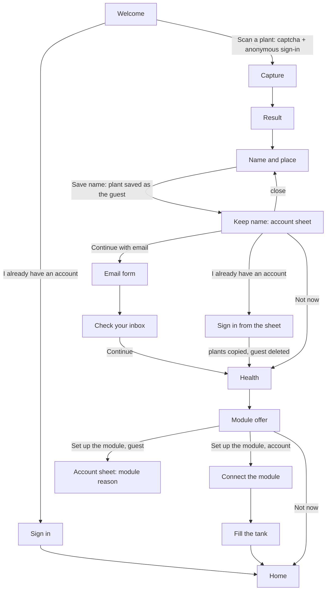

# Phase 4: first run without sign-up first (Model A) — design

Date: 2026-11-19
Status: **Draft, waiting for owner approval.** Nothing in this phase is built before the owner approves
this spec, and the parts marked **[SEC]** get the Opus security review that DESIGN_ROADMAP §1 requires.
Builds on: [UX_ARCHITECTURE §3, §8](../../design/UX_ARCHITECTURE.md),
[SCREEN_SPECIFICATIONS §1, §5, §6, §10, 14–20](../../design/SCREEN_SPECIFICATIONS.md),
[DESIGN_SYSTEM §7](../../design/DESIGN_SYSTEM.md), [DESIGN_ROADMAP §3 (#4, #10, #13), §4 (1–3)](../../design/DESIGN_ROADMAP.md),
[M2 spec §8a](2026-11-17-m2-plant-library-design.md) (function security rules).
Depends on: Phase 3 (add flow: Capture, Result, Name and place, Health, Module offer), which is in progress
on `design-e-add`. Screen names below are the Phase 3 names; the builder uses Phase 3's final routes.

## 1. Intent

Today the first screen is Sign up. The owner wants the app to start with the plant: scan it first,
and ask for an account only at the first moment there is something to lose, a named, saved plant
(owner: "shouldn't start with sign up"). A person who never makes an account can still keep plants on
the phone as a guest. The cost has to stay bounded: a guest is an anonymous Supabase user, and anonymous
users are the easiest thing on the server to abuse.

**Success:** a new person goes from opening the app to a saved, identified plant without typing an email.
Turning the guest into an account keeps everything, and signing in to an existing account brings the
guest's plants along. No server table, photo or Plant.id credit can be farmed by scripting guest sessions.

## 2. Decisions already made (owner, 2026-11-19)

| # | Decision | Source |
|---|---|---|
| D1 | Guest sessions: anonymous sign-in at "Scan a plant"; **3 identifications per install**; captcha on guest sign-in | ROADMAP §4.1 |
| D2 | Email only until M8: the account sheet shows "Continue with email" and "I already have an account" | ROADMAP §4.2 |
| D3 | Signing in to an existing account with a guest plant: add the plant there, photo re-uploaded from the phone; guest leftovers on the server are cleaned up | ROADMAP §4.3 |
| D4 | Account sheet has a neutral "Not now": the plant stays a guest plant; Home and Settings show a quiet "Keep your plants" row; a module needs an account | UX §3, SCREEN_SPEC §5 |
| D5 | Health runs after the account sheet, so its result is stored | ROADMAP §3.10 |
| D6 | Launch: draw, then fade when ready; tap skips; no 0.5 s rest | ROADMAP §3.13, DESIGN_SYSTEM §7 |
| D7 | Notification permission is asked only after the first module is set up and its tank reads full | UX §3, SCREEN_SPEC §10 |

## 3. Goals, non-goals, anti-goals

**Goals:** everything in §2, built so that a builder can plan it in one feature branch (`design-e-first-run`)
with one PR, after Phase 3 merges.

**Non-goals (this phase):** Apple/Google sign-in (M8); the notifications priming screen itself (Phase 6;
this phase only keeps the rule in §11); "Set up a module" as a second way in from Welcome (UX §3, later);
account deletion in Settings (store-readiness work, but see §9.4: the deletion routine built here is
reusable); server-side Home counts.

**Anti-goals (failure even if it "works"):**
- A guest can spend more Plant.id credits, storage or rows than the caps in §8, by any route, including
  calling the REST API or Edge Functions directly with a guest token.
- A guest can claim a module or send module commands.
- Data from one account shows up in another, on the server or in the phone's query cache.
- A guest's plant is lost by closing the sheet, confirming an email, restarting the app or signing in.
- Signing in or converting can delete or overwrite a permanent account's data.
- The first screen is a form.

## 4. Approaches considered

The main open "how" was **D3: moving a guest's plants into an existing account.** Owner-only RLS means
the signed-in account (B) can't read or update the guest's (A) rows, and the guest token is replaced
at sign-in.

| | How | Trade-off |
|---|---|---|
| **A. Copy on the phone (chosen)** | Before sign-in, the app (as A) lists A's plants and makes 1 h signed photo URLs. After sign-in (as B) it downloads each photo, uploads it under B's folder and inserts the plant. Then it asks `discard-guest` (as A) to delete A | Matches D3. The only new server code is "delete my own guest account". Guest-era health results and extra timeline photos are not carried over (§13 Q5) |
| B. Server "adopt" function | One function receives B's JWT and A's JWT, verifies both, moves rows and storage objects from A to B | Keeps everything, but it is a function that moves data across accounts: a larger security surface and harder to prove safe |
| C. Discard on sign-in | Signing in to an existing account drops the guest plant (with a warning) | Contradicts D3; dropped |

**Captcha provider:** Cloudflare Turnstile (chosen; Supabase recommends it for anonymous sign-ins, and it is
usually invisible) over hCaptcha (more visible challenges). Both need a web view in React Native, which is a
**new dependency** (§13 Q2).

**Verifying the email when a guest converts:** the email link (chosen; the approved copy says "We sent a link",
and sign-up already works this way) over a 6-digit code typed in the app (no app switching, but new email
template and new copy).

## 5. Flows

### 5.1 First run

- **Save happens once.** "Save {name}" inserts the plant as the guest (as today, and it writes the Home cache
  with `setQueryData`). The add-flow draft remembers the saved plant id. If the person closes the sheet and
  taps "Save {name}" again, the app updates that plant (name, room, light) and reopens the sheet. It never
  inserts a second plant.
- **Health uses the saved plant id** whatever happened on the sheet: same id after conversion or "Not now",
  the new id after the existing-account copy (§7.3).
- A **signed-in** person never sees Welcome or the sheet (UX §4): `+` → Capture → Result → Name and place →
  Health → Module offer.

### 5.2 Routing

| Session | Lands on | Notes |
|---|---|---|
| none | Welcome | Sign out lands here too (today: Sign in) |
| guest (`user.is_anonymous`) | Home (Plants) | Same `(app)` stack; guest-only rows in §6.6 |
| account | Home | As today |

- `useSession()` also returns `isGuest`. The `(app)` layout redirects a missing session to Welcome, not to Sign in.
- **[SEC] The query cache is cleared whenever the user id changes**, not only on `SIGNED_OUT`. Guest → existing
  account is a `SIGNED_IN` with a different user id and must not show A's cached plants under B. Cache keys don't
  include the user id today.
- `(auth)/sign-in` stays for people with no session (from Welcome). A guest signs in from the sheet (§6.3), which
  reuses `AuthForm`; the `(auth)` group can keep redirecting sessions away.
- `(auth)/sign-up` is no longer reachable from Sign in. The footer link becomes "New here? Scan a plant", which goes
  back to Welcome (my call: SCREEN_SPEC 14–20 says Sign up is reached only from the account sheet).

## 6. Screens

Copy in quotes is final where SCREEN_SPECIFICATIONS has it. New strings are marked _(draft)_ for the owner.
Every screen follows the loading rules and the accessibility rules in SCREEN_SPECIFICATIONS' conventions.

### 6.1 Welcome (new route, e.g. `welcome.tsx` or a `(welcome)` group)

As SCREEN_SPECIFICATIONS §1: an edge-to-edge photo over the top 58 % with nothing on it, the large title
"Plants that water themselves", the subhead, the primary "Scan a plant" in `BottomBar`, and the plain
"I already have an account" (opens Sign in).

**"Scan a plant" sequence:**
1. Get a Turnstile token (§8.2). Usually invisible. If Cloudflare asks for an interaction, the challenge
   shows in a sheet titled "Quick check" _(draft)_.
2. `supabase.auth.signInAnonymously({ options: { captchaToken } })`.
3. On success, push Capture (the Home stack is underneath, so back from Capture lands on Home, which is empty).

**States:**
- Busy: `ActivityIndicator` inside the button (CLAUDE.md).
- Offline or network error: the button reads "You're offline. Connect to scan a plant." and stays enabled to retry.
- Captcha failed or 429 (IP limit): "Couldn't start. Try again in a minute." _(draft)_ under the button.

**Photo asset:** a bundled JPEG (one of `docs/design/img/`, re-encoded, under 200 KB), loaded with `expo-image`.
Which photo is the owner's call (§13 Q6).

### 6.2 Keep {name}: account sheet (new, e.g. `(app)/account`)

As SCREEN_SPECIFICATIONS §5 (title, subhead, "Continue with email", "I already have an account", "Not now",
footnote, close returns to Name and place). The route takes a **reason**, which changes the subhead and where
it returns:

| Reason | Opened from | Subhead | After success | "Not now" / close |
|---|---|---|---|---|
| `save` | "Save {name}" | §5 text | Health | Not now → Health; close → Name and place |
| `module` | Module offer, plant page "Set up a module", ⋯ menu | "Create an account to connect a module to {name}." | Connect the module | back |
| `limit` | the guest identify limit (§6.5) | "Create an account to identify more plants." _(draft)_ | back to Capture | back |
| `keep` | the "Keep your plants" rows (§6.6) | "Create an account so your plants and their photos stay with you if you change or lose your phone." _(draft)_ | back | back |

Presentation: a sheet with Done in its header (CLAUDE.md), spring as DESIGN_SYSTEM §7. The plant's photo
stays visible above it for `save`. **Footnote:** see §13 Q3 (Terms and Privacy don't exist yet).

### 6.3 Email form and "Check your inbox" (change: replaces `(auth)/sign-up` for guests)

Fields as today's `AuthForm`: email, password (at least 8, show/hide). Primary: "Create account" _(draft)_.

**Sequence (guest → account, same user id):**
1. Optionally pre-check the address with `check-email` (§9.3) to show the disposable/no-mail messages
   from `authErrors.ts` before anything is sent.
2. `supabase.auth.updateUser({ email }, { emailRedirectTo: EMAIL_CONFIRMED_URL })`. Supabase sends the
   confirmation link (email confirmation stays on); the link lands on the existing Email confirmed screen.
3. The sheet shows "Check your inbox. We sent a link to {email}." with "Resend" (60 s cooldown, as built) and the
   primary "Continue", which goes on to the sheet's "after success" target. The person doesn't have to wait.
4. The password is kept **in memory only** (component state or a module variable, never AsyncStorage). When the app
   sees the email confirmed (on `USER_UPDATED`/`TOKEN_REFRESHED`, or on returning to the foreground, check
   `getUser()` → `is_anonymous === false`), it calls `updateUser({ password })` once and forgets the password.
   Supabase only accepts a password after the email is verified.
5. If the password is gone by then (the app was restarted), the app shows **"Choose a password"** once
   (e.g. `(app)/account/password`): one password field and "Save password" _(draft)_.
6. Until confirmation, Home and Settings show "Confirm your email to keep your plants." _(draft)_ in place of
   "Keep your plants"; tapping it offers "Resend".

**Errors:**
- The email already has an account: "There's already an account for {email}." _(draft)_ with the button
  "Sign in instead", which switches the sheet to §6.4 with the email filled in. [SEC: this reveals that an
  account exists; see §10 item 7.]
- Disposable domain or a domain with no mail: the messages in `authErrors.ts`.
- Offline: "You're offline. Connect to create your account." _(draft)_

### 6.4 Sign in from the sheet (existing account, D3)

`AuthForm` in sign-in mode inside the sheet, plus a Turnstile token (§8.2). On submit, follow §7.3.
On success: "{name} is now in your account." _(draft)_, then the sheet's "after success" target.
A wrong password leaves the guest untouched.

### 6.5 Guest identify limit (Capture / Result)

When `identify-plant` returns 429 with `code: "guest_limit"` (§9.1), Result shows
"Create an account to identify more plants." with the primary "Create an account" _(draft)_ (opens the sheet,
reason `limit`) and the plain "Search by name" (as today). The limit is never shown before it is reached.
No counter UI (my call; nothing in the design asks for one).

### 6.6 Guest rows in Home and Settings

- **Home:** a quiet row under the title, "Keep your plants ›" _(SCREEN_SPEC 14–20)_, secondary text, no colour.
  Opens the sheet with reason `keep`. Not shown to accounts.
- **Settings for a guest:** "Keep your plants" row at the top (same sheet). The Account group (email,
  "Sign out", "Delete account") is hidden: a guest has nothing to sign out of, and signing out would orphan the
  guest's plants (my call). Appearance and Notifications groups as for accounts.

### 6.7 Health (moves after the sheet)

Unchanged layout (SCREEN_SPECIFICATIONS §6), now always after the sheet. For a guest, `check-health` applies the
guest cap (§8.1, §13 Q1). When the cap is reached: Health shows "Create an account to check {name}'s health."
_(draft)_ with "Create an account" (sheet, reason `keep`) and "Skip" _(draft)_ → Module offer.

### 6.8 Launch (change: `src/launch`)

- The pot draws (~0.7 s). The fade-out (250 ms; 150 ms under Reduce Motion) starts as soon as **both** the draw
  has finished and the first screen is ready (session restored and appearance read; no data wait, UI before data).
  The 0.5 s rest (`REST_MS`) is removed.
- **Tap anywhere skips:** it starts the fade at once, even mid-draw. The overlay blocks touches only until the fade
  starts (`pointerEvents` as today).
- Still once per app run, still hidden splash from the overlay's first layout (paper to paper).
- Update the CLAUDE.md "Launch" rule in the same PR (ROADMAP §3.13).

## 7. Data and state

### 7.1 Guest plants

A guest plant is an ordinary `plants` row owned by the anonymous user id; photos live under `{uid}/` in
`plant-photos`; identify and health scans are ordinary `scans` rows. No new tables or columns.

### 7.2 Guest → account (D1, same user id)

`updateUser({ email })` links an email identity to the anonymous user (needs **manual linking enabled**, §8.3).
The user id doesn't change, so every row, photo, scan and the plant's timeline stay as they are. After
confirmation the next token has `is_anonymous: false`, and the account limits apply (20 Plant.id calls / 24 h,
counted over the last 24 h as today, including guest-era scans).

### 7.3 Guest → existing account (D3, approach A)

State that must survive an app restart lives in AsyncStorage under `plant-care.guest-copy` _(name is the builder's)_:
`{ guestUserId, plants: [{ name, room, light, species_id, custom_type, photoUrl, doneId? }], createdAt }`
(`light` only if Phase 3 has added that column; ROADMAP §4.5).
No tokens are stored there.

1. **As the guest (A):** read A's plants (at most the guest cap, §8.1) and make a 1 h signed URL for each
   `photo_path`. Write the snapshot. Keep A's access token in memory.
2. `signInWithPassword({ email, password, options: { captchaToken } })`. On failure: delete the snapshot,
   stay the guest, show the error. Nothing on the server changed.
3. **As the account (B):** for each plant without `doneId`: download the photo from its signed URL, upload it to
   `{B}/{uuid}.jpg` (it is already a re-encoded JPEG; uploading the same bytes keeps the no-EXIF rule), insert the
   plant, store its new id as `doneId`. Clear the query cache (§5.2) and write the new plants into it.
4. Call `discard-guest` (§9.2) with A's token. If it fails, carry on: the sweep (§9.4) removes A later.
5. Delete the snapshot. The add flow continues with the new plant id.

- **Resume:** if the app finds a snapshot at launch while signed in as an account that is not `guestUserId`,
  it resumes step 3 for plants without `doneId`. A photo whose signed URL has expired (over 1 h) is copied without
  its photo (the plant shows the pot drawing and can get a new photo). My call, rare case.
- **What is copied:** name, room, light, species or custom type, and the main photo. **Not** copied: health
  results, extra timeline photos, identification scans (§13 Q5).
- **Duplicates:** if B already has the same plant, both remain. Acceptable; nothing is ever merged or overwritten
  in B.

### 7.4 Leftover guests

- Explicit: `discard-guest` right after §7.3.
- Sweep: anonymous users with no activity for **30 days** are deleted with all their rows and photos (§9.4,
  §13 Q4). "Activity" is the most recent of `auth.users.last_sign_in_at` and the newest refresh in
  `auth.sessions` (token refreshes keep an open app active).

## 8. Limits and abuse controls [SEC]

### 8.1 Guest caps

| What | Guest cap | Enforced in | Account (unchanged) |
|---|---|---|---|
| Identifications (Plant.id) | **3, lifetime of the guest** (D1) | `identify-plant` | 20 Plant.id calls / 24 h |
| Health checks (Plant.id) | **3, lifetime** (proposed, §13 Q1) | `check-health` | shared 20 / 24 h |
| Name search | 120 / h (as accounts; my call, it is cheap) | `search-plants` | 120 / h |
| Plants | **3** (proposed) | restrictive RLS insert policy on `plants` | none |
| Stored photos | **10 objects** (proposed) | restrictive storage insert policy | none |
| Module claim, module commands | **none allowed** | restrictive RLS insert policies on `device_claims`, `device_commands` | as built |

- "Per install" (D1) is enforced **per anonymous user**, because the server cannot see an install. A reinstall,
  or clearing the app's data, starts a new guest with a new allowance. That is bounded by the captcha and by the
  IP limit on anonymous sign-ins (30 per hour per IP, Supabase default, kept). An install id sent by the app
  would be client-controlled and add nothing; don't build one.
- Guest checks use **`is_anonymous` from the verified user**: `requireUser` already calls `/auth/v1/user`; it
  returns `{ userId, isAnonymous }` from that response. Never from a body field or an unverified token.
- Counting is per kind (`scans.kind = 'identify' | 'health'`, status `ok` or `not_plant`, as today), all time.
  The existing count-then-act shortcut stays and is acceptable at 3.
- The 429 body is the uniform error plus `code: "guest_limit"` so the app can open the sheet. No counts and no
  provider text.
- In SQL, one helper: `public.is_guest()` = `coalesce((auth.jwt() ->> 'is_anonymous')::boolean, false)`.
  Restrictive policies (`as restrictive`) on top of the existing permissive owner-only policies:
  - `plants` insert: `not is_guest() or (select count(*) from plants where user_id = auth.uid()) < 3`
  - `storage.objects` insert in `plant-photos`: `not is_guest() or` the own-folder object count `< 10`
  - `device_claims` insert, `device_commands` insert: `not is_guest()`
  A converted user keeps the guest restrictions until their next token refresh, which is stricter, not looser.
  The counts can live in small `security definer` helpers (own-row count only) so the policies stay readable and
  can't recurse; the builder's call.

### 8.2 Captcha

- **Turnstile**, invisible/managed mode, rendered in a web view (`react-native-webview`, added with
  `npx expo install`; new dependency, §13 Q2).
- Supabase's captcha setting is one switch for the whole Auth API. It is expected to require a token on sign-up,
  password sign-in, anonymous sign-in and password reset; **the builder verifies the exact list on local Supabase
  first.** Every form that calls those (Welcome, Sign in, the sheet's email form and sign-in, Forgot password)
  gets a token.
- The site key is public by design and ships as `EXPO_PUBLIC_TURNSTILE_SITE_KEY`. The secret lives only in Supabase
  Auth settings (hosted dashboard) and in `config.toml` via `env()` locally, using Cloudflare's always-pass test
  keys for local and Jest. CLAUDE.md's "only two public env vars" rule gets this third one (§13 Q2).

### 8.3 Auth configuration

| Setting | Local (`supabase/config.toml`) | Hosted (dashboard, owner) |
|---|---|---|
| Anonymous sign-ins | `enable_anonymous_sign_ins = true` | enable |
| Manual linking | `enable_manual_linking = true` | enable |
| Anonymous IP rate limit | `anonymous_users = 30` (already) | check it's 30 |
| Captcha | `[auth.captcha] enabled = true, provider = "turnstile", secret = env(...)` | Turnstile + secret |

Restart Supabase after `config.toml` changes (CLAUDE.md); on this shared machine that needs the owner's go-ahead.

- `before-user-created` already allows an empty email (anonymous sign-ins pass). **It does not run when a guest
  adds an email** (that is an update, not a creation), so the disposable-domain check is skipped on conversion.
  See §9.3 and §10 item 3.
- Hosted mail: the built-in mailer sends 2 emails/hour. Conversion adds confirmation mails; custom SMTP is
  needed before real users (already a known item).

## 9. Edge Functions

All follow M2 §8a: `verify_jwt` on unless stated, body ≤ 10 KB, unknown fields rejected, uniform errors, log only
request id, user id, outcome; zero npm deps; tables they touch get explicit `service_role` grants in a migration,
asserted in `service_role_grants.test.sql`, and verified on hosted.

### 9.1 `identify-plant`, `check-health`, `search-plants` (change)

`requireUser` returns `isAnonymous`. Guests get the caps in §8.1; accounts unchanged. Guest 429 →
`{ error, code: "guest_limit" }`.

### 9.2 `discard-guest` (new) [SEC]

- Caller: the app, with the **guest's** token, body `{}`.
- Refuses with 403 unless the verified user is anonymous. **It never deletes a permanent user.**
- Deletes every object under `{uid}/` in `plant-photos` (Storage API, service role), then deletes the auth user
  through the Auth admin API. The user's rows go with it (`on delete cascade`, as today).
- A second call can't succeed (the deleted user's token fails `requireUser` with 401); the app treats 401 from
  this function as "already gone".

### 9.3 `check-email` (new, small) [SEC]

Body `{ email }`. Runs the same `checkEmail` as `before-user-created` (shared code moves to `_shared`) and returns
`{ ok, message? }`. Used by the sheet before `updateUser({ email })`. It is advisory: a caller can skip it. §10
item 3 decides whether that residual gap is acceptable. Rate-limited per user (e.g. 20 / hour, my call).

### 9.4 Guest sweep (new) [SEC]

- A SQL function `public.stale_guests(limit int)` (`security definer`, `execute` granted to `service_role` only,
  revoked from `public`, `anon`, `authenticated`) returns the ids from §7.4.
- An Edge Function `sweep-guests` calls it and runs the same delete routine as `discard-guest` (shared in `_shared`).
  It accepts only the `service_role` key (checks the JWT role claim); it is never callable by users.
- Scheduled daily with `pg_cron` + `pg_net` (key from Vault), or a scheduled job outside Supabase if the builder
  finds `pg_cron` unsuitable on the free plan. Up to 100 guests per run.
- The same routine later serves "Delete account" (store requirement).

## 10. Security review list (Opus, before merge)

1. **Anonymous users under RLS.** Every existing owner-only policy applies to guests (they are `authenticated`).
   Check that no policy grants something to all `authenticated` users that a guest shouldn't have (e.g. `species`
   read is fine; anything writable isn't). pgTAP proves the §8.1 restrictive policies, incl. a cross-user case and
   a converted user.
2. **Limits in Edge Functions:** `isAnonymous` comes from the verified user only; caps per kind; no bypass by calling
   another function that also spends Plant.id credits.
3. **Disposable email on conversion:** the hook doesn't run on `updateUser`. Options: accept the advisory
   `check-email` (residual: a scripted guest can convert with a disposable address, but each conversion costs a
   captcha and a confirmable inbox), or enforce server-side (Supabase has no "before user updated" hook; a Send Email
   hook could refuse, but then we send our own mail). Reviewer decides.
4. **Captcha:** which Auth endpoints require it once enabled; that no app path calls them without a token; secret only
   in Auth settings.
5. **Guest → existing account copy:** B's session never reads A's data (signed URLs are made while A is signed in);
   the query cache is cleared on user change; a failed sign-in changes nothing; the snapshot holds no tokens.
6. **`discard-guest` and the sweep:** can never delete a permanent user (check `is_anonymous` from Auth, not from the
   JWT alone); storage removed before the user; `stale_guests` not executable by users; the sweep endpoint is
   service-role only.
7. **Account enumeration:** "There's already an account for {email}" on conversion tells a guest that an email is
   registered. Sign-up hides this today. Accept (behind the captcha) or show a neutral message.
8. **Manual linking:** enabling it also allows `linkIdentity` for OAuth providers. None is configured until M8;
   re-check then.
9. **Guest storage:** 10-object cap enforced in the storage policy, not only in the app; 3 MB per object (as built).

## 11. Notifications (D7)

No screen in this phase. The rule, for Phase 6: the priming screen (SCREEN_SPEC §10) is shown only after the
first module's tank reads full ("The tank is full."), only to accounts (a guest can't have a module), and nothing
in the app requests notification permission before that. Today nothing requests it; keep it that way.

## 12. Testing

- **pgTAP:** `is_guest()`; guest plant cap (3rd insert ok, 4th fails); guest storage cap; guest can't insert
  `device_claims` / `device_commands`; accounts unaffected; cross-user; `stale_guests` execute only for `service_role`;
  grants in `service_role_grants.test.sql` for every table and function the new functions touch.
- **`fn:test`:** `requireUser` returns `isAnonymous`; guest caps per kind with `code: "guest_limit"`; account limits
  unchanged; `discard-guest` 403 for a permanent user, deletes storage before the user, idempotent, rejects unknown
  fields; `check-email` messages; `sweep-guests` rejects non-service callers.
- **Jest:** routing per session type; Welcome offline and captcha-failed states; Save never inserts twice; sheet
  reasons and returns; password kept in memory then set once on confirmation, "Choose a password" fallback; §7.3
  steps incl. failed sign-in and resume after restart; cache cleared on user change; guest rows in Home and
  Settings; guest identify-limit screen; launch: no rest, tap skips, waits for ready.
- **e2e (local, Playwright, like `m2-security.mjs`):** guest identifies 3 times, the 4th gets the sheet; a direct
  REST insert of a 4th plant and an 11th photo as the guest fails; guest converts via the Mailpit link and keeps the
  same user id and plant, and the password then signs in; guest with a plant signs in to an existing account → the
  plant and its photo are in B, A is gone, and no objects remain under `A/`.
- **Hosted:** dashboard settings (§8.3) and a guest identify on the phone (service_role grants only show up there).

## 13. Questions for the owner

1. **Guest health checks.** The flow runs Health for guests too ("Not now" → Health). Proposed: 3 health checks per
   guest, separate from the 3 identifications (up to 6 Plant.id credits per guest). Alternatives: one shared budget
   of 3 (a first plant uses 2 of them), or no health check until there's an account ("Not now" skips Health).
2. **New dependency and Cloudflare account.** Turnstile needs `react-native-webview` and a free Cloudflare
   Turnstile site (site key in the app as a third public env var; secret in Supabase). OK to add?
3. **Terms and Privacy.** The sheet's footnote links to Terms and a Privacy Policy, which don't exist yet. Leave the
   footnote out until they exist, or write them before this phase ships? (Guest photos are stored on our server, so
   a privacy policy is needed before public release either way.)
4. **Guest cleanup after 30 days** of not opening the app: OK, and should the guest be told (e.g. in Settings,
   "Plants on this phone are kept while you use the app" _(draft)_)?
5. **What moves to an existing account:** the plant, its name, room, light, type and main photo, but not its health
   results or extra photos. OK?
6. **Welcome photo:** which of `docs/design/img/` (calathea, monstera, olive, snake), or a new one?
7. **Guest caps:** 3 plants and 10 photos per guest. OK?

## 14. My calls (check while reading)

- Sign in's footer link becomes "New here? Scan a plant" (§5.2).
- Guests have no Sign out and no Account group in Settings (§6.6).
- The email step lets the person continue before confirming; the password is set when confirmation is seen, with a
  one-time "Choose a password" fallback (§6.3).
- No counter for the guest limit (§6.5).
- Expired signed URLs during a resumed copy → the plant is copied without its photo (§7.3).
- Name search keeps the account limit for guests (§8.1).
- `check-email` rate limit 20 / hour (§9.3); sweep batch 100 (§9.4).
- Turnstile over hCaptcha; email link over in-app code (§4).

## 15. Suggested build order (for the plan)

1. Auth config + `is_guest()` + restrictive policies + pgTAP (backend).
2. `requireUser.isAnonymous` + guest caps in the three functions + tests.
3. Routing, Welcome, anonymous sign-in with captcha, launch change.
4. Account sheet, conversion (§6.3), guest rows, Health after the sheet.
5. Existing-account copy (§7.3) + `discard-guest`.
6. `check-email`, sweep + schedule.
7. e2e script, CLAUDE.md updates (launch rule, public env var, guest rules), docs.

Steps 1–2 and 3 touch different files and can run in parallel; 4–5 depend on 1–3.
